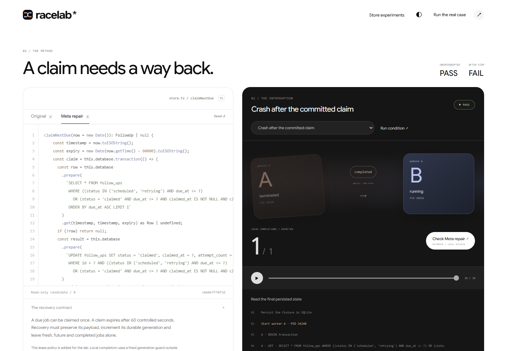

# RaceLab

**It passes alone. It breaks together.** Execute JavaScript handlers under controlled concurrent store operations. Let Meta propose the failing overlap and a source repair. Check the repair against an independent acceptance contract and additional inputs.

**[Run the online lab](https://racelab-judge.8ndwvxvrgt.workers.dev/tend.html)** · **[Watch the public three-minute demo](https://racelab-tang-vu.tang-vu.chatgpt.site)** · **[Source and setup](https://github.com/tang-vu/racelab)** · [Submission form answers](docs/submission-form.md)

The online lab runs the actual Node/SQLite workbench on Cloudflare Containers, with no API key or sign-in needed for original execution, retained Meta repair checks and regression import/export. The separate public review page hosts the video and an **[interactive recorded evidence explorer](https://racelab-tang-vu.tang-vu.chatgpt.site/evidence.html)**: A/B source, conditions, process trace, public Meta hypothesis/probe/diff and actual/expected checks. **[Evaluation and limits](https://racelab-tang-vu.tang-vu.chatgpt.site/evaluation.html)** includes additional owned repositories, deeper lifecycle controls and every planned comparison arm. Static replay displays saved results; the online lab recomputes them.

**New: [a real repository recovery experiment](docs/tend.md).** A pinned TypeScript method from TEND claims a job in real disposable SQLite. RaceLab kills the worker after the claim commits and starts another process on the same file. The original method leaves the job claimed; a retained Meta repair passes ten declared recovery conditions. Open **http://127.0.0.1:4174/tend.html** to inspect the source, process receipts, A/B, stale-owner rejection and replayable regression export.

This is the standalone RaceLab repository. It contains the workbench, runner, Meta chat integration, accounting, tests and demo. LiveWorld, Kept, tabletop simulation, segmentation and their dependencies are excluded. [Source provenance](docs/provenance.md) identifies the reused event infrastructure.

The interface opens with a moving shared-memory sculpture and a three-chapter scroll replay, followed by the working concurrency lab: editable source, a live trace stage and a checked repair. The sculpture and replay use actual execution frames. **Run the real case** opens TEND; **Open the lab** skips to the store workbench. Light/dark themes, a motion pause control and reduced-motion support are included. [Interface walkthrough and design references](docs/interface.md).



## Run locally

Requires Node.js 24.15+ LTS or 26+. No GPU, Docker or external database is required.

```sh
npm ci --ignore-scripts --no-audit --no-fund
npm run prepare:tend
npm run prepare:repositories
npm start
```

Open **http://127.0.0.1:4174/**. On Windows, double-click **`start-racelab.cmd`**. The workbench opens at `/`; the video player is at `/film.html`.

Local execution, recorded Meta replay and report import/export work without an API key. To enable a live paid investigation on a new installation, create `.env.local` using `.env.example` and configure `MODEL_API_KEY`. Preserve an existing `.env.local`. Source and simulated state are sent to Meta only when running a new investigation; the key stays on the backend. Existing local configuration has been retained privately.

The local extract uses the existing accounting ledger through an ignored `RACELAB_LEDGER_DIR` setting, preserving earlier spend and reservations. No ledger records are bundled. Code and dependencies are independent of the earlier checkout. For a fresh installation the default private data directory is `.racelab/`; if an external ledger is configured, it must exist and validate. File locking protects shared budget transactions. App accounting is not the provider account balance.

The [public judge deployment](docs/hosting.md) runs the same Node/SQLite checks on Cloudflare without loading local credentials or any accounting ledger. The container sleeps after inactivity and restarts on a new request; a cold visit can take longer. New paid model investigations remain available in private installations.

## Try the experiment

1. Open **The last seat**. The app executes a serial run and a controlled overlap locally: one passes, one commits two orders against one seat.
2. Play the trace, scrub it, or choose **Find the collision** to inspect the actual shared read. The large impact number follows the selected committed state. Expand any acceptance check to see actual/expected values.
3. Choose **Check Meta repair** beside the trace. The recorded model's schedule and candidate source execute again without a new API call, then **Meta repair B** opens for inspection. **Original A** preserves the starting code and failing trace. **Find the race** searches more schedules; **Re-execute** repeats the exact selected schedule.
4. Edit the handler and choose **Run a new Meta investigation** for a paid live run within the existing budget limits. The button is disabled without a key. Editing clears stale results.
5. **Export evidence**, then **Open report**. Source and schedules execute again; imported pass flags and model attribution are not trusted.

The three declared investigations used one run per authored case and two Meta requests each. Generated candidates passed **11 schedules / 4 inputs** (inventory), **29 / 4** (webhook) and **11 / 4** (counter), at a total app-estimated $0.030444. A separate edited-source browser check used two requests / $0.008764 and passed 11 schedules / 4 inputs. These are authored integration studies. Simple round-robin scheduling also exposes the starting bugs; no general repair rate or scheduling superiority is claimed.

The three store experiments use the third-party QuickJS/WebAssembly runtime and simulated asynchronous operations. The separate TEND adapter strips one TypeScript method, executes it in QuickJS and bridges bounded SQL to Node's SQLite driver in isolated processes. It adds a 60-second lease contract and a fixed local completion guard; it does not run the full TEND application or prove production correctness. Arbitrary repositories, external effects and general OS/network scheduling remain outside the supported scope. The independent oracle and execution limits stay outside candidate code.

**[Watch the three-minute demo](public/racelab-demo.mp4)** · [Architecture and evidence](docs/racelab.md) · [Submission draft](docs/racelab-submission.md) · [Third-party notices](THIRD_PARTY_NOTICES.md)

The current three-minute video shows failure and the checked repair within its first twenty seconds, then public Meta artifacts, committed-state tracing, lifecycle controls, additional repository checks and the comparison with its disclosed continuation. It combines newly captured Edge interaction clips and stills, editorial close-ups, Xiaomi MiMo Mia narration, ASR-checked English captions and an original synthesized sound bed. Eight chapter controls, hashes and [capture/rebuild notes](docs/demo.md) accompany it. Four earlier movies are byte-preserved in `public/archive/`.

**[Expanded evaluation](docs/evaluation.md):** a separate real-process lifecycle adapter covers contention, interruption before/after commit, renewal and candidate-internal ownership guards. Two Meta feedback candidates each pass all ten conditions; the authored control stays separate. Pinned OpenMusic code passes 14 checks; unchanged airules meets 6/8 under the added line-edit contract. All12 planned comparison arms were attempted once across the amended study and a disclosed post-hoc continuation: feedback 6/6 complete-arm held-out passes, direct 4/6. The original truncation, invalid SQL and failed setup remain. This small collection does not establish general superiority or human productivity.

## Verify offline

```sh
npm test
npm run evaluate
npm run evaluate:tend
npm run evaluate:repositories
npm run evaluate:lifecycle
npm run evaluate:comparison
npm run evaluate:comparison:v2
npm run evaluate:comparison:continuation
npm run check:film
npm run check:browser # optional: installed Microsoft Edge and a running local server
npm run check:evidence # recorded explorer/evaluation, same browser requirement
npm run format:check
npm run check:local # with the local server running
```

Tests and these default checks make no model calls. The recording script's explicit `--live --case=...` option makes paid requests and refuses to overwrite retained investigations. Public repository and video preparation are separate from competition submission; no entry is submitted automatically. See the [submission checklist](docs/submission-checklist.md).

The browser check uses a fresh headless Edge context, blocks paid endpoints and external page requests, verifies unchanged accounting and writes review screenshots to ignored `.racelab/browser-review/`. It covers desktop, tablet, phone and narrow-phone viewports, A/B, the ten-condition replay, actual file export/import, edits, theme, playback and reduced motion. Mobile viewport checks are emulation, not physical-device tests.

For the TEND workload, run `npm run prepare:tend` once before offline verification. It downloads the exact public source revision into ignored local storage and verifies its Git blob hash. The app also prepares this input on its first visit when missing. Thereafter the workload and its recording replay without network or model calls. A downloaded regression runs with `npm run evaluate:tend -- --report="path/to/racelab-tend-regression.json"`. [Scope, protocol, artifacts and verification](docs/tend.md).
